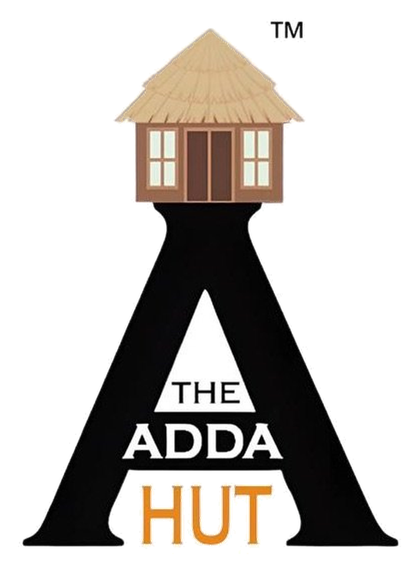

 <div align="center">
  
  <h1>The Adda Hut × Vayora</h1>
  <p><strong>A cinematic website concept for private celebrations in Siliguri, West Bengal.</strong></p>
  <p>
    <a href="https://the-adda-hut-demo.netlify.app/"><strong>View Live Demo ↗</strong></a>
    ·
    <a href="#features">Features</a>
    ·
    <a href="#run-locally">Run Locally</a>
    ·
    <a href="#deployment">Deployment</a>
  </p>
</div>

---

> **Concept preview by Vayora.** This project is a design and development demonstration for The Adda Hut. It is not the venue's official website or an authorised replacement. Business details, services, imagery and launch permissions must be confirmed before production use.

## Overview

The Adda Hut website concept explores a more distinctive digital presence for a private celebration venue in Siliguri. The visual direction is built around the supplied hut-and-lettermark logo, using ink black, warm ivory, straw gold and terracotta with expressive typography, editorial layouts and restrained scroll-driven motion.

The goal is to give visitors a clear path from discovering an occasion idea to making an enquiry, while keeping the interface responsive, accessible and usable when motion enhancements are unavailable.

**Live demo:** [the-adda-hut-demo.netlify.app](https://the-adda-hut-demo.netlify.app/)

## Features

- **Editorial, responsive layouts** designed for mobile, tablet and desktop screens.
- **Brand-led art direction** using the supplied logo and a warm, celebration-inspired visual system.
- **Occasion explorer** for switching between celebration concepts and carrying a selection into the enquiry form.
- **Motion enhancements** using GSAP and ScrollTrigger, loaded as progressive enhancement.
- **Gallery interactions** with category filters, a lightbox, keyboard controls and touch-friendly navigation.
- **Accessible navigation** with a mobile menu, keyboard focus handling, semantic markup and reduced-motion support.
- **Enquiry form** with client-side validation and fields for occasion details and preferences.
- **WhatsApp enquiry handoff** that prepares a message for the visitor to review and send. It does not send messages automatically.
- **Location and contact actions** including map directions, phone, Instagram and public-review links.
- **Central business configuration** so contact details, location and displayed review figures can be updated in one place.
- **Static Netlify deployment** with a build script that assembles the deployable site in `dist/`.

## Tech Stack

- HTML5
- CSS3 with responsive layouts, design tokens, focus styles and reduced-motion rules
- Vanilla JavaScript using ES modules
- GSAP + ScrollTrigger for progressive motion enhancements
- Node.js built-in modules for the local preview server and static build script
- Netlify for hosting

The project is intentionally dependency-light. It does not use React or Next.js, and the current package manifest has no runtime npm dependencies. Google Fonts, GSAP/ScrollTrigger, map embeds and illustrative image assets load remotely, so an internet connection is needed for those enhancements and media.

## Run Locally

### Requirements

- Node.js **20 or newer**
- npm
- An internet connection for remote fonts, images, maps and animation enhancements

### Install and start

```bash
npm ci
npm run check
npm run dev
```

Open [http://127.0.0.1:4173](http://127.0.0.1:4173) in your browser. Stop the server with `Ctrl+C`.

The `npm start` command runs the same local server:

```bash
npm start
```

### Build the static site

```bash
npm run build
```

This runs the project checks, then copies the deployable website and required assets into `dist/`. It is a static-file assembly step, not a framework bundler.

## Deployment

The repository includes `netlify.toml`, which configures the Netlify build and publish settings.

| Netlify setting | Value |
| --- | --- |
| Base directory | Leave blank (repository root) |
| Build command | `npm run build` |
| Publish directory | `dist` |
| Node version | `20` |

For continuous deployment, push the repository to GitHub and connect that repository to Netlify. Netlify will run the configured build command and publish `dist/`.

For a manual Netlify Drop deployment, run `npm ci && npm run build`, then upload the **contents of the generated `dist/` folder**. Do not upload the unbuilt source directory as the publish folder.

## Project Structure

```text
.
├── index.html                  # Page structure, content and metadata
├── styles.css                  # Design tokens, responsive styles and motion states
├── src/
│   ├── app.js                  # Navigation, occasion explorer, gallery and enquiry interactions
│   └── business-config.js      # Central business details and public-review values
├── public/
│   └── brand/
│       ├── logo-original.png   # Preserved source logo
│       ├── logo-transparent.png
│       ├── favicon-64.png
│       └── app-icon.png
├── scripts/
│   ├── check-project.mjs       # Dependency-free project checks
│   └── build.mjs               # Creates and validates dist/
├── docs/
│   ├── ANIMATION_GUIDE.md
│   ├── ASSET_CREDITS.md
│   ├── BUILD_AND_RUN.md
│   ├── CONTENT_VERIFICATION.md
│   ├── DESIGN_AND_SKILL_AUDIT.md
│   ├── FILE_MANIFEST.md
│   └── TEST_REPORT.md
├── netlify.toml                # Netlify build configuration
├── robots.txt                  # Blocks crawler indexing during concept review
├── package.json
└── README.md
```

## Business Configuration

Update `src/business-config.js` to change shared details such as the business name, address, phone and WhatsApp numbers, Instagram URL, map destination, review link, rating and review count.

These details are not a live feed from Google or the venue. Review figures are static values from the configuration and must be re-checked before launch. Confirm the preferred booking number, address and map pin directly with the venue owner.

## Content, Media and Launch Readiness

This is a **concept preview**, not a completed operational booking platform. Before using it as the venue's production website:

1. Replace illustrative stock photography with current, authorised photos of The Adda Hut where possible. Stock imagery must not be represented as photographs of the actual venue.
2. Confirm the logo and all media usage rights, and review the sources in [`docs/ASSET_CREDITS.md`](docs/ASSET_CREDITS.md).
3. Confirm the address, preferred booking number, hours, menu, event offerings, capacity, packages, prices and terms directly with the owner.
4. Re-check the public review rating and count, then update `src/business-config.js`.
5. Review privacy, terms, accessibility, performance and production hosting requirements.
6. After the owner has approved the concept, update the `noindex, nofollow` metadata in `index.html` and the restrictive `robots.txt` only when the site is ready to be indexed.

For details and outstanding confirmations, see [`docs/CONTENT_VERIFICATION.md`](docs/CONTENT_VERIFICATION.md). For recorded checks and their limitations, see [`docs/TEST_REPORT.md`](docs/TEST_REPORT.md).

### Current limitations

- The enquiry flow opens a prefilled WhatsApp draft; it does not create a confirmed booking, send messages automatically or save form submissions to a server.
- No live availability, booking inventory, payment flow or backend database is included.
- Opening hours, package prices, venue capacity and a full official menu are not published because they require direct confirmation.
- Photography is illustrative Pexels imagery, not verified photography of the property.
- External assets and embeds may not load when a visitor is offline or blocks third-party requests.

## Credits

- **Concept and implementation:** Vayora
- **Brand asset:** Logo supplied for this project; original source retained under `public/brand/`
- **Illustrative photography:** Pexels; source and asset notes are recorded in [`docs/ASSET_CREDITS.md`](docs/ASSET_CREDITS.md)
- **Animation:** GSAP and ScrollTrigger, loaded from their external CDN

## License

No open-source license is currently specified for this repository. Do not assume that the brand assets, photographs or project code are available for unrestricted reuse. Confirm the relevant permissions before redistributing or using the concept commercially.

---

<div align="center">
  <sub>Concept experience by Vayora · Made for The Adda Hut</sub>
</div>
